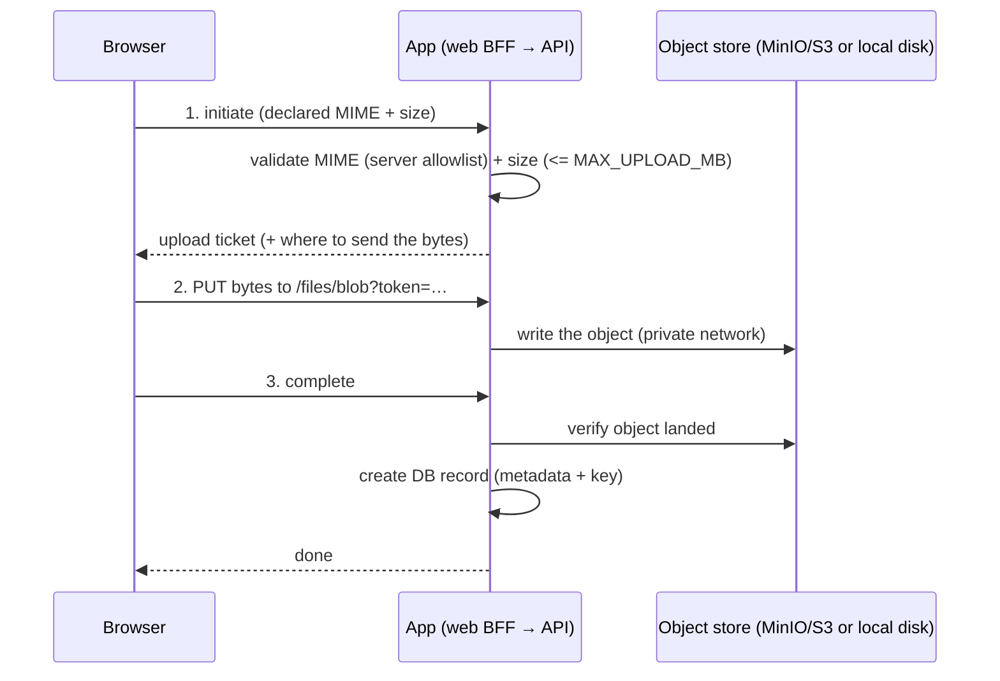

# Object Storage

How InfluenceOS stores attachment **blobs** (campaign and influencer files), how
uploads and downloads work, how the store is configured, and what durability the
store must provide in production. This is operational reference for anyone
running or recovering the platform.

> **Scope.** All object access is mediated by the API — by default the browser
> never talks to the store at all, and never with long-lived credentials.
> Creators reach only their own task link's upload address.

## 1. Driver selection

`STORAGE_DRIVER` selects the storage backend:

| `STORAGE_DRIVER` | Backend | Use for |
|---|---|---|
| `local` | Files on local disk under `/uploads` | Development / single-host only |
| `s3` | S3-compatible object storage (AWS S3 or self-hosted MinIO) | Production, multi-host |

The `local` driver keeps blobs on the host filesystem. It is single-host by
construction: a second API/worker instance cannot see another host's `/uploads`,
so it is a development-only convenience. Any real deployment uses `s3`.

## 2. Private by default — and how the browser reaches files

Buckets are **PRIVATE**. Objects are **never** public and there is no anonymous
read path. Every upload is authorized by a signed, expiring **upload ticket** and
every download by a signed, expiring **download link**, each scoped to one object.

How the browser moves the bytes is set by `S3_BROWSER_ACCESS` (`s3` driver only;
the `local` driver always works like `proxy`):

| `S3_BROWSER_ACCESS` | Upload | Download | Store reachable from the internet? |
|---|---|---|---|
| `proxy` **(default)** | Browser → app (`PUT /files/blob`) → API writes to the store over the private network | Browser ← app (`GET /files/:id/blob?token=…`, byte ranges) ← API reads the store | **No** — nothing to set up |
| `direct` | Browser → presigned PUT on `S3_PUBLIC_ENDPOINT` | Presigned GET on `S3_PUBLIC_ENDPOINT` | **Yes**, over HTTPS, with CORS for the app's origin |

`proxy` is the default because it needs nothing: the store stays on the private
network, there is no files domain, no CORS, no mixed content and no CSP entry.
`direct` is only for a store that is really served to browsers (a TLS files
domain in front of MinIO, or S3/R2 with CORS) — and only worth it for very large
files, where sending them through the app would cost bandwidth.

> **Why this matters.** With `direct` and a store browsers can't reach — the
> shipped `docker-compose.full.yml` binds MinIO to `127.0.0.1` and the shipped
> Caddy/nginx configs don't route to it — every browser upload fails with
> *"Upload failed — network error."* and stored images don't show. That was the
> default before; `proxy` is the default now.

- A client never holds the bucket credentials.
- The reverse proxy does not expose the store; it is reachable only on the
  private network.

## 3. Two-phase, signed upload flow

Uploads are two-phase and signed. The API authorizes the transfer, the bytes go
to the API (or, with `direct`, straight to the store), and the DB record is
created only after the object is confirmed to have landed.



**Step 1 — initiate.** The client declares the file's MIME type and size. The
API validates the MIME type against a **server-side allowlist** and checks the
declared size against the ceiling `MAX_UPLOAD_MB`. On success the API returns an
**upload ticket**. Validation is server-side; a client cannot bypass the
allowlist or the size ceiling.

**Step 2 — transfer.** The client PUTs the bytes to the app's upload address
(`proxy`, the default). The request is counted by the rate limit first, then the
API checks the session and the ticket **before it reads the body** (a forged
ticket, or one made for someone else, never makes the API take in a large
upload), requires **exactly** the declared number of bytes, and writes them to
the store. The web BFF in front still reads the whole body before forwarding
it, so on the way the upload must fit the reverse proxy's body cap (120 MB as
shipped) and the web server's request window (16 minutes, raised from Node's 5
by `apps/web/scripts/start.cjs`; upload tickets are valid 15). With `direct`,
the browser PUTs a presigned URL instead; the declared size is baked into its
signature.

**Step 3 — complete.** The client calls `complete`. The API **verifies the
object actually landed** in the store, then creates the DB record holding the
attachment's metadata and object key. If the object is not present, no DB record
is created.

A creator's draft file from their task link follows the same three steps through
the link's own address (`PUT /public/creator/:token/uploads?ticket=…`).

## 4. Downloads

Downloads never expose the bucket:

| Mode | Download mechanism |
|---|---|
| `proxy` (default) and `local` | A **signed link** served by the API: `GET /files/:id/blob?token=...`. It streams the file, answers byte ranges (206, or 416 out of range — video players need them), and stays the same for an hour (valid one to two hours) so browsers cache it (`Cache-Control: private, max-age=3600, no-transform`). Pictures, video and PDF open inline; other files download. Everything but PDFs carries `Content-Security-Policy: sandbox`, which the BFF passes through. |
| `direct` | A **presigned GET URL** to the object; expires after 10 minutes. |

In both cases the grant is scoped to a single object and time-limited. Saved
post covers use their own day-stable signed link (`GET /covers/:id`).

With the `s3` driver, downloads read the store over their own connection pool
(100 sockets, a connection idle for 60 seconds is closed), so slow or stalled
viewers can't use up the connections uploads need.

> **Logs.** The API's access log replaces the `token`, `ticket` and `s` query
> parameters with `[redacted]`. The reverse proxy's (Caddy/nginx) access log
> records the full URL — if you keep it, treat it as sensitive (it holds
> download links valid up to two hours) or filter those query parameters.

## 5. Internal vs public endpoint

| Env var | Used by | Purpose |
|---|---|---|
| `S3_INTERNAL_ENDPOINT` | The server (API/worker) | Reach the store on the **private network** — all reads and writes |
| `S3_PUBLIC_ENDPOINT` | The browser (`direct` only) | The browser-facing endpoint presigned URLs are **signed for** |
| `S3_ENDPOINT` (legacy) | Both (fallback) | Fallback for both of the above when the split pair is unset |

With `direct`, presigned URLs are signed directly against `S3_PUBLIC_ENDPOINT`
(the signature covers its scheme, host and port), so whatever fronts the store
must forward requests with that same `Host`, no added path prefix, and HTTPS.

```bash
# Default — nothing about the store is public:
S3_INTERNAL_ENDPOINT=http://minio:9000
# S3_BROWSER_ACCESS unset (= proxy); S3_PUBLIC_ENDPOINT is not used.

# Opt-in direct access through a TLS files domain in front of MinIO:
S3_BROWSER_ACCESS=direct
S3_PUBLIC_ENDPOINT=https://files.example.com
```

## 6. MIME allowlist and size ceiling

- **MIME allowlist** — enforced server-side at `initiate`. Only MIME types on
  the allowlist are accepted; the check cannot be skipped by the client.
- **Size ceiling** — the declared size must be `<= MAX_UPLOAD_MB` (default
  `50`). The declared size is checked at `initiate` before a ticket is issued.
  The shipped Caddy/nginx configs cap request bodies at 120 MB, so raise those
  too before setting `MAX_UPLOAD_MB` above that.

## 7. Environment variables

| Variable | Applies to | Required | Notes |
|---|---|---|---|
| `STORAGE_DRIVER` | all | yes | `local` or `s3` |
| `MAX_UPLOAD_MB` | all | no | Upload size ceiling; default `50` (the shipped proxies cap bodies at 120 MB) |
| `S3_INTERNAL_ENDPOINT` | `s3` | yes* | Server-side endpoint on the private network |
| `S3_BROWSER_ACCESS` | `s3` | no | `proxy` (default — files go through the app) or `direct` (presigned URLs) |
| `S3_PUBLIC_ENDPOINT` | `s3` + `direct` | with `direct` | Browser-facing HTTPS endpoint presigned URLs are signed for |
| `S3_ENDPOINT` | `s3` | fallback | Legacy single endpoint; fallback for both of the above |
| `S3_BUCKET` | `s3` | yes | Bucket name (private) |
| `S3_ACCESS_KEY_ID` | `s3` | yes | Access key |
| `S3_SECRET_ACCESS_KEY` | `s3` | yes | Secret key |
| `S3_REGION` | `s3` | no | Region |
| `S3_FORCE_PATH_STYLE` | `s3` | no | `true` for MinIO / path-style addressing |

\* The env contract requires **an endpoint** (`S3_INTERNAL_ENDPOINT`, or the
legacy `S3_ENDPOINT` fallback) plus a bucket, access key, and secret — and
`S3_PUBLIC_ENDPOINT` when `S3_BROWSER_ACCESS=direct`.

### Fail-fast contract

The env contract in `apps/api/src/env.ts` **requires** endpoint + bucket + access
key + secret when `STORAGE_DRIVER=s3`, and `S3_PUBLIC_ENDPOINT` with
`S3_BROWSER_ACCESS=direct`. If any of these is missing, the API **refuses to
boot** — it does not start with a half-configured store. `scripts/preflight.sh`
also fails `direct` with an address browsers can't reach (localhost, `127.*`,
the example domain, the internal `minio` name), warns on `http://`, and fails
any value other than `proxy` or `direct`.

```bash
# Minimum valid s3 configuration (MinIO / path-style):
STORAGE_DRIVER=s3
S3_INTERNAL_ENDPOINT=http://minio:9000
S3_BUCKET=influenceos
S3_ACCESS_KEY_ID=...
S3_SECRET_ACCESS_KEY=...
S3_FORCE_PATH_STYLE=true
```

## 8. Durability (production requirement)

**Object storage is the source of truth for attachment blobs.** The database
holds only their **metadata and object keys** — not the bytes.

> **Losing the bucket means losing the files.** If the bucket is lost, the DB
> rows remain but every download **404s**. The blobs are gone; the metadata
> pointing at them is not enough to reconstruct them.

Because the store is the system of record for blobs, it **must be durable**:

- **Managed S3** with built-in redundancy, **or**
- **Self-hosted MinIO** with **erasure coding / replication** **and its own
  backup**. MinIO redundancy protects against disk/node loss; it is not a
  substitute for a backup that protects against deletion, corruption, or
  operator error.
- **Recommended:** enable **bucket versioning**.
- **Ideally:** configure **cross-region / replication**.

> **The app-DB backup does NOT back up object storage.** This is called out
> explicitly: whatever backs up PostgreSQL does not touch the bucket. Object
> storage needs its own, separate durability and backup plan. A DB restore
> recovers metadata only — it cannot recover a lost blob.

## 9. Choosing a store: managed S3 vs self-hosted MinIO

| | Managed S3 (e.g. AWS S3) | Self-hosted MinIO |
|---|---|---|
| Redundancy | Built-in, provider-managed | You must configure erasure coding / replication |
| Backups | Still your responsibility (versioning + lifecycle/replication) | Entirely your responsibility — MinIO needs its **own** backup |
| Operational burden | Low — no store to run | Higher — you run, patch, and monitor MinIO |
| Network | Typically publicly reachable; internal/public endpoints often identical | Usually on the private network; internal ≠ public endpoint (see §5) |
| Path style | Virtual-hosted style | Path-style — set `S3_FORCE_PATH_STYLE=true` |
| Cost model | Per-GB + egress | Your hardware |

Both are valid. Whichever you pick, the durability requirements in §8 apply:
redundancy **and** a separate backup, and remember the DB backup does not cover
blobs.

## 10. How it's verified

Object storage is exercised by CI, not just asserted:

- **MinIO round-trip (integration test).** CI runs a real MinIO round-trip
  against the `s3` driver.
- **Files through the app (integration test).** `files-through-app.test.ts`
  runs the `s3` driver with an **unreachable** public endpoint: upload,
  complete, download, byte ranges, a Story image, a creator's draft, and the
  upload checks (session, ticket owner, exact size). Real MinIO in CI, an
  in-process stand-in elsewhere.
- **`e2e-s3` CI job.** The browser journeys — **upload → download → delete**,
  and a **Story image** upload — run against a private MinIO the browser can't
  reach (no CORS, unreachable public endpoint), exactly like production.
- **Direct mode.** `s3-storage.test.ts` keeps the presigned PUT/GET round-trip
  (`S3_BROWSER_ACCESS=direct`), including the signed-size edge cap.

These are the guard against regressions in the two-phase upload, the
browser access modes, and the internal/public endpoint split.

## 11. A bucket-only storage account (recommended)

By default the API and worker use the MinIO root user. That account can do
anything to every bucket and to MinIO itself. A dedicated user limited to the
`influenceos` bucket is enough for the app. With the MinIO client (`mc`) on the
server:

```bash
# 1. Point mc at your MinIO with the root account (once).
mc alias set local http://localhost:9000 "$MINIO_ROOT_USER" "$MINIO_ROOT_PASSWORD"

# 2. A policy that allows only the influenceos bucket.
cat > /tmp/influenceos-app.json <<'JSON'
{
  "Version": "2012-10-17",
  "Statement": [
    { "Effect": "Allow", "Action": ["s3:GetBucketLocation", "s3:ListBucket"], "Resource": ["arn:aws:s3:::influenceos"] },
    { "Effect": "Allow", "Action": ["s3:GetObject", "s3:PutObject", "s3:DeleteObject"], "Resource": ["arn:aws:s3:::influenceos/*"] }
  ]
}
JSON
mc admin policy create local influenceos-app /tmp/influenceos-app.json

# 3. The user, with a long random secret, and the policy attached.
mc admin user add local influenceos-app "$(openssl rand -hex 24)"   # note the secret you pass here
mc admin policy attach local influenceos-app --user influenceos-app
```

Then set `S3_ACCESS_KEY_ID=influenceos-app` and `S3_SECRET_ACCESS_KEY=<that
secret>` for the API and worker (keep `MINIO_ROOT_USER` / `MINIO_ROOT_PASSWORD`
for MinIO itself) and restart them. Uploading, opening and deleting a file in
the app confirms it works. Bucket setup (CORS, creating the bucket) still needs
the root account, which is what the `minio-init` one-shot uses.

